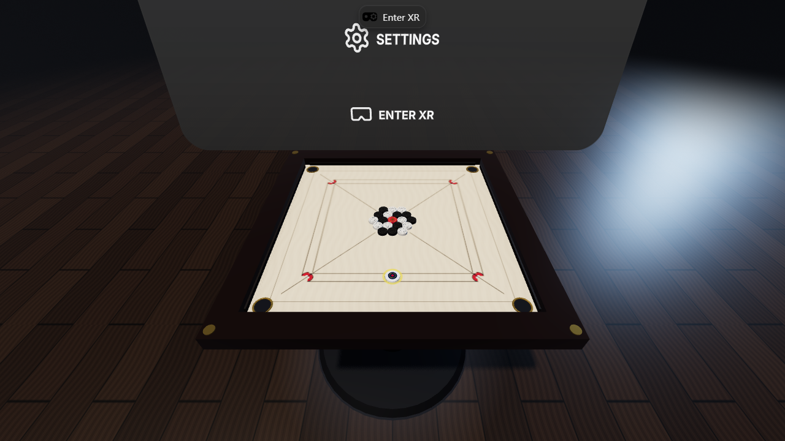

# CARROM CLASH

> A modern 3D carrom gaming experience powered by immersive interactions.

<p align="center">
  
</p>

---

## Live Demo

Experience CARROM CLASH directly in your browser on desktop, mobile, or Meta Quest:

<p align="center">
  <a href="https://game224.vercel.app/">
    
  </a>
</p>

> **Deployment Link Note**: Replace `https://your-vercel-deployment.vercel.app` with your actual Vercel production URL once deployed via `npx vercel --prod`.

---

## Gameplay Demo

<p align="center">
  <video src="docs/videos/carrom-clash-walkthrough.webm" controls width="100%"></video>
  <br />
  <em>Complete Gameplay Walkthrough: Main Menu, Slingshot Aiming, Live Power Arc, Break Shot & Physical Collisions</em>
</p>

---

## Key Features

- **Realistic 3D Carrom Environment**  
  Competition-grade wooden carrom board with accurate pocket cutouts, polished hardwood cushions, and PBR coins (9 White, 9 Black, 1 Red Queen, 1 Striker) rendered in a dark studio setting.

- **Deterministic Planar Physics**  
  Sub-stepped physics engine simulating disc-to-disc elastic collisions, cushion bounce restitution, boric-powder surface friction, and 4 corner pocket triggers.

- **Slingshot Aiming & Shot Power**  
  Intuitive 3-phase striker control: slide freely along the baseline, pull backward to project an aim guide and build power, then release to shoot.

- **Game Modes**  
  - **Solo Practice**: Solo training mode with shot counters and re-rack controls.  
  - **Play vs AI Bot**: Smart computer opponent that dynamically targets coins toward open pockets.  
  - **Pass-and-Play Multiplayer**: Local turn-based competition for 2, 3, or 4 players with turn handover prompts and individual scoreboards.

- **Mobile Touch Controls**  
  Full mobile browser preview support: single-finger drag to position and aim, release to shoot, and two-finger pinch/drag for camera orbit and zoom.

- **WebXR & Hand Tracking**  
  Native Meta Quest Browser support: grab and aim the striker naturally with index-thumb pinch gestures or 6DoF Touch controllers.

- **Procedural Sound Engine**  
  Zero-latency procedural Web Audio synthesis for timber strikes, cushion rebounds, and pocket drops.

---

## Controls Quick Guide

| Action | Desktop (Mouse & Keyboard) | Mobile (Touch) | Meta Quest VR |
| :--- | :--- | :--- | :--- |
| **Position Striker** | Click baseline or press `A` / `D` | Tap along bottom baseline | Pinch & slide along baseline |
| **Aim & Charge** | Drag backward from striker | Touch & pull backward | Pinch striker & pull backward |
| **Shoot** | Release left mouse button | Release touch | Release pinch gesture |
| **Orbit / Zoom** | Right-click / Middle-click drag | Two-finger drag & pinch | Head movement (6DoF) |
| **Toggle Camera** | Press `C` (Angled 3D / Top-Down) | Settings Panel toggle | Native spatial perspective |

---

## Technology Stack

- **Meta Immersive Web SDK (`@iwsdk/core`)**: WebXR lifecycle, ECS world management, and Quest hand tracking
- **Three.js**: PBR materials, custom geometry, lighting, and camera system
- **TypeScript & Vite**: Strict type safety and rapid HMR development build pipeline
- **UIKitML**: Floating dark-glass spatial UI panels
- **Web Audio API**: Synthetic physical audio engine for real-time sound effects

---

## How to Run Locally

### Prerequisites
- Node.js 18+ and npm

### Installation
```bash
# 1. Clone repository
git clone https://github.com/your-username/carrom-clash.git
cd carrom-clash

# 2. Install dependencies
npm install

# 3. Start development server with live HTTPS
npm run dev:runtime
```

Open the application:
- **Desktop**: `https://localhost:8081/`
- **Mobile / Quest (Same Wi-Fi)**: `https://<YOUR_LOCAL_IP>:8081/`  
  *(Accept the local self-signed HTTPS certificate warning when prompted).*

### Production Build
```bash
npm run typecheck
npm run build
```

---

## Deployment to Vercel

The project includes a ready-to-use `vercel.json` configured with cross-origin isolation headers for WebAssembly physics:

```bash
# Log in to Vercel
npx vercel login

# Deploy directly to production
npx vercel --prod
```

---

## Credits

Created for the WebXR / 3D Web Hackathon. Built with the **Meta Immersive Web SDK (IWSDK)** and **Three.js**.

---

## License

This project is licensed under the [MIT License](LICENSE). Feel free to use, modify, and distribute it for personal and commercial projects.
